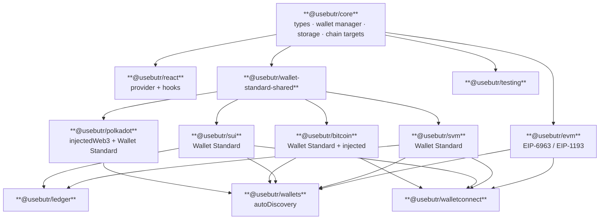

<div align="center">
  <picture>
    <source media="(prefers-color-scheme: dark)" srcset="./assets/butr-logo-dark.svg">
    
  </picture>
  <p>Multi-chain wallet discovery and connection state for React</p>
  <p><a href="https://www.usebutr.com">Website</a> · <a href="https://docs.usebutr.com">Docs</a> · <a href="https://demo.usebutr.com">Live demo</a> · <a href="https://www.npmjs.com/package/@usebutr/wallets">npm package page</a></p>
  <p>
    <a href="https://www.npmjs.com/package/@usebutr/react"></a>
    <a href="https://www.npmjs.com/package/@usebutr/wallets"></a>
    <a href="https://github.com/pedroapfilho/usebutr/actions/workflows/test.yml"></a>
    <a href="./LICENSE"></a>
  </p>
</div>

butr is a multi-chain wallet management library for React. It discovers EVM, Solana, Sui, Bitcoin, and Polkadot wallets in the browser, manages their connections across the lifetime of an app, and exposes them through composable hooks, so a single component can talk to a MetaMask account, a Phantom Solana account, a Sui Wallet account, and an Xverse Bitcoin account in the same render pass.

The library is split across small focused packages so consumers bundle only what they need. The monorepo also ships fifteen demo apps that exercise butr across the major React frameworks and integration patterns.

**At a glance**

- **What it is.** A discovery + connection-state layer for browser wallets across EVM, SVM, Sui, Bitcoin, and Polkadot.
- **What it gives you.** A typed React store + hooks; one provider; persisted connections; multi-wallet, multi-chain in a single render pass.
- **Who it's for.** Apps that need more than one chain side by side (EVM + Solana + Sui + Bitcoin + Polkadot) and any app that wants standards-first discovery (EIP-6963 + Wallet Standard) without coupling to a chain library or connect-modal UI.
- **Docs.** Full reference and guides at [`docs.usebutr.com`](https://docs.usebutr.com).

## Quickstart

```bash
pnpm add @usebutr/core @usebutr/react @usebutr/wallets zustand
```

Mount the provider once. Its `config.sources` say where adapters come from. `autoDiscovery()` is one source for every platform: EIP-6963 EVM wallets, Wallet Standard Solana, Sui and Bitcoin wallets, `window.injectedWeb3` Polkadot extensions, and the fallback channels (`window.ethereum`, the injected Unisat, OKX and Xverse providers, `window.btc`, Wallet Standard `polkadot:*`). It lists a wallet present on two channels once.

```tsx
// src/wallet-provider.tsx
import type { WalletManagerConfig } from "@usebutr/core";
import { WalletManagerProvider } from "@usebutr/react";
import { autoDiscovery } from "@usebutr/wallets";
import type { ReactNode } from "react";

// Read once at mount: define it at module scope.
const config: WalletManagerConfig = {
  sources: [autoDiscovery()],
};

export const WalletProvider = ({ children }: { children: ReactNode }) => (
  <WalletManagerProvider config={config}>{children}</WalletManagerProvider>
);
```

Then read from hooks anywhere below the provider:

```tsx
// src/connect-button.tsx
import {
  useConnect,
  useConnectedWallets,
  useDiscoveredWallets,
  useIsHydrated,
  useWalletManager,
} from "@usebutr/react";

export const ConnectButton = () => {
  const isHydrated = useIsHydrated();
  const discovered = useDiscoveredWallets();
  const connected = useConnectedWallets();
  const { connect, connectingId, error } = useConnect();
  const { disconnect } = useWalletManager();

  // Client-only rendering: the pool is empty until the start-up hydration pass.
  // For SSR, seed the manager with `initialState` and skip this gate; see
  // https://docs.usebutr.com/concepts/hydration
  if (!isHydrated) return null;

  return (
    <div>
      {discovered.map((w) => (
        <button disabled={connectingId !== null} key={w.id} onClick={() => connect(w.id)}>
          Connect {w.name} ({w.chainPlatform})
        </button>
      ))}
      {connected.map((w) => (
        <button key={w.connector.id} onClick={() => disconnect(w.connector.id)}>
          Disconnect {w.connector.name}
        </button>
      ))}
      {error ? <p role="alert">{error.message}</p> : null}
    </div>
  );
};
```

`connect` never rejects: a failure lands in `error` as a `ConnectionError` with a `kind`. Signing, balances, chain switching, and per-platform composition all build on the same provider and hooks.

## Highlights

- **Multi-chain by default.** EVM (EIP-1193 / EIP-6963), Solana (Wallet Standard), Sui (Wallet Standard), Bitcoin (Wallet Standard + injected fallback for sats-connect / Unisat / OKX), and Polkadot (`injectedWeb3` + Wallet Standard) on equal footing. No "one chain at a time" mode.
- **Framework-agnostic core.** `@usebutr/core` is React-free. `@usebutr/react` is the binding, not the foundation. Use the core directly from any TS runtime.
- **Modular packages.** Install only the protocol adapters you ship. EVM-only dapp? Skip `@usebutr/svm` entirely.
- **No middleware lock-in.** Every adapter is just a `WalletAdapter`. Bring WalletConnect, Ledger, or your own.
- **Composes with the ecosystem.** Sits beside viem, wagmi, `gill`, framework-kit (`@solana/client` + `@solana/react-hooks`), `@solana/kit`, `@solana/wallet-adapter-react` (and legacy `@solana/web3.js`). butr owns discovery and connection state; your existing library owns RPC and signing.

## When to use butr

| Reach for butr when…                                                                | Reach for something else when…                                                  |
| ----------------------------------------------------------------------------------- | ------------------------------------------------------------------------------- |
| You need EVM **and** Solana side by side in the same app.                           | You're single-chain EVM and already happy with wagmi + RainbowKit.              |
| You want raw signers + your own UI, not a prefab connect modal.                     | You want a turnkey modal and don't mind the chain-library coupling that brings. |
| You care about standards (EIP-6963 + Wallet Standard) over per-wallet branch lists. | You need account abstraction, in-app wallets, or social login as the product.   |

butr deliberately does **not** ship an RPC client, a connect-modal UI, key custody, balance reads, or a transaction builder. It hands off cleanly to viem, wagmi, `@solana/kit`, `gill`, etc.

## Packages

Twelve published packages, each with a single responsibility.

| Package                           | Purpose                                                                                               | Install                                                                               |
| --------------------------------- | ----------------------------------------------------------------------------------------------------- | ------------------------------------------------------------------------------------- |
| `@usebutr/core`                   | Types, wallet manager, storage, chain targets, and the `WalletSource` seam. No React, no protocols.   | `pnpm add @usebutr/core zustand`                                                      |
| `@usebutr/react`                  | React provider and hooks on top of `@usebutr/core`.                                                   | `pnpm add @usebutr/react zustand`                                                     |
| `@usebutr/evm`                    | EIP-1193 / EIP-6963 / injected wallet discovery and adapters.                                         | `pnpm add @usebutr/evm zustand`                                                       |
| `@usebutr/svm`                    | Wallet Standard adapter for Solana / SVM.                                                             | `pnpm add @usebutr/svm zustand @wallet-standard/app`                                  |
| `@usebutr/sui`                    | Wallet Standard adapter for Sui.                                                                      | `pnpm add @usebutr/sui zustand @wallet-standard/app`                                  |
| `@usebutr/bitcoin`                | Wallet Standard adapter for Bitcoin + injected fallback (sats-connect / Unisat / OKX / `window.btc`). | `pnpm add @usebutr/bitcoin zustand @wallet-standard/app`                              |
| `@usebutr/polkadot`               | Polkadot adapter: `window.injectedWeb3` discovery + Wallet Standard `polkadot:*` fallback.            | `pnpm add @usebutr/polkadot zustand @wallet-standard/app`                             |
| `@usebutr/wallet-standard-shared` | Shared Wallet Standard plumbing used by the SVM / Sui / Bitcoin / Polkadot adapters.                  | `pnpm add @usebutr/wallet-standard-shared zustand @wallet-standard/app`               |
| `@usebutr/wallets`                | Batteries-included composition: EVM + SVM + Sui + Bitcoin + Polkadot discovery + `autoDiscovery()`.   | `pnpm add @usebutr/react @usebutr/wallets zustand`                                    |
| `@usebutr/walletconnect`          | WalletConnect v2 adapter for EVM / SVM / Sui / Bitcoin namespaces, single or multi-namespace.         | `pnpm add @usebutr/walletconnect zustand @walletconnect/universal-provider`           |
| `@usebutr/ledger`                 | Ledger hardware-wallet adapter for EVM / SVM / Sui / Bitcoin over WebUSB.                             | `pnpm add @usebutr/ledger zustand @ledgerhq/hw-app-eth @ledgerhq/hw-transport-webusb` |
| `@usebutr/testing`                | Fake adapters, fake persistence, and the adapter contract suite (`@usebutr/testing/contract`).        | `pnpm add -D @usebutr/testing zustand`                                                |

> Workspace-internal packages (`@repo/typescript-config`, `@repo/config-vitest`, `@repo/wallet-extensions`) back the monorepo's tooling and tests and are not published.

## Architecture



`@usebutr/core` owns the types and the wallet manager. Every package builds the same `WalletAdapter` shape and resolves each call's chain and account through core's chain targets, so the same refusal raises the same `ConnectionError` kind everywhere. A `WalletSource` is `(onAdapter) => unsubscribe`: every `discover*Adapters` export is one, `autoDiscovery()` composes them for every platform, and `fromAdapters()` turns built adapters (WalletConnect, Ledger, your own) into one. `@usebutr/react` needs only `@usebutr/core`; pick the platform packages directly to ship one platform.

## Recipes

Every recipe passes a module-scope `WalletManagerConfig` to `WalletManagerProvider`. Without React, pass the same config to `createWalletManager` from `@usebutr/core` and call `manager.start()`.

<details>
<summary><b>Multi-chain (batteries-included)</b>: one source for EVM, Solana, Sui, Bitcoin and Polkadot</summary>

```tsx
// apps/demo-vite/src/wallet-provider.tsx
import type { WalletManagerConfig } from "@usebutr/core";
import { WalletManagerProvider } from "@usebutr/react";
import { autoDiscovery } from "@usebutr/wallets";
import type { ReactNode } from "react";

const config: WalletManagerConfig = {
  sources: [autoDiscovery()],
};

export const WalletProvider = ({ children }: { children: ReactNode }) => (
  <WalletManagerProvider config={config}>{children}</WalletManagerProvider>
);
```

`useConnectedWallets()` returns every connected wallet across platforms. Pass a platform list to discover only those, e.g. `autoDiscovery(["evm", "svm"])`, and `{ fallbacks: false }` to skip the fallback channels.

</details>

<details>
<summary><b>EVM-only</b>: one platform package, no <code>@usebutr/wallets</code></summary>

```tsx
// apps/demo-with-viem/src/wallet-provider.tsx
import type { WalletManagerConfig } from "@usebutr/core";
import { discoverEvmAdapters } from "@usebutr/evm";
import { WalletManagerProvider } from "@usebutr/react";
import type { ReactNode } from "react";

const config: WalletManagerConfig = {
  sources: [discoverEvmAdapters],
};

export const WalletProvider = ({ children }: { children: ReactNode }) => (
  <WalletManagerProvider config={config}>{children}</WalletManagerProvider>
);
```

Every `discover*Adapters` export is a `WalletSource` as-is. `discoverInjectedAdapter` adds `window.ethereum`, but on its own it also lists a wallet that announced through EIP-6963; `autoDiscovery(["evm"])` lists it only when no wallet announced.

</details>

<details>
<summary><b>SVM-only</b>: Wallet Standard, no EVM code shipped</summary>

```tsx
// apps/demo-with-solana-kit/src/wallet-provider.tsx
import type { WalletManagerConfig } from "@usebutr/core";
import { WalletManagerProvider } from "@usebutr/react";
import { discoverSvmAdapters } from "@usebutr/svm";
import type { ReactNode } from "react";

const config: WalletManagerConfig = {
  sources: [discoverSvmAdapters],
};

export const WalletProvider = ({ children }: { children: ReactNode }) => (
  <WalletManagerProvider config={config}>{children}</WalletManagerProvider>
);
```

</details>

<details>
<summary><b>Sui-only</b>: Wallet Standard, no EVM, Solana or Bitcoin code shipped</summary>

```tsx
// apps/demo-with-sui/src/wallet-provider.tsx
import type { WalletManagerConfig } from "@usebutr/core";
import { WalletManagerProvider } from "@usebutr/react";
import { discoverSuiAdapters } from "@usebutr/sui";
import type { ReactNode } from "react";

const config: WalletManagerConfig = {
  sources: [discoverSuiAdapters],
};

export const WalletProvider = ({ children }: { children: ReactNode }) => (
  <WalletManagerProvider config={config}>{children}</WalletManagerProvider>
);
```

</details>

<details>
<summary><b>Bitcoin-only</b>: Wallet Standard plus the injected Bitcoin wallets</summary>

```tsx
// apps/demo-with-bitcoin/src/wallet-provider.tsx
import type { WalletManagerConfig } from "@usebutr/core";
import { WalletManagerProvider } from "@usebutr/react";
import { autoDiscovery } from "@usebutr/wallets";
import type { ReactNode } from "react";

const config: WalletManagerConfig = {
  sources: [autoDiscovery(["bitcoin"])],
};

export const WalletProvider = ({ children }: { children: ReactNode }) => (
  <WalletManagerProvider config={config}>{children}</WalletManagerProvider>
);
```

Lists Wallet Standard Bitcoin wallets (Phantom, Magic Eden, Leather, OKX) and the injected Unisat, OKX and Xverse providers, each wallet once. `window.btc` names no wallet, so it lists only when no other Bitcoin wallet was found.

</details>

<details>
<summary><b>SSR (Next.js App Router)</b>: render persisted connections from the first paint</summary>

```ts
// apps/demo-next/src/wallet-storage.ts
import { createCookieWalletStorage } from "@usebutr/core";

// Outside the "use client" module, so the Server Component receives the object.
export const walletStorage = createCookieWalletStorage({
  keyPrefix: "my-app",
  secure: process.env.NODE_ENV === "production",
});
```

```tsx
// apps/demo-next/src/wallet-provider.tsx
"use client";

import type { WalletManagerConfig, WalletSnapshot } from "@usebutr/core";
import { discoverEvmAdapters } from "@usebutr/evm";
import { WalletManagerProvider } from "@usebutr/react";
import type { ReactNode } from "react";

import { walletStorage } from "./wallet-storage";

const config: WalletManagerConfig = {
  sources: [discoverEvmAdapters],
  storage: walletStorage,
};

export const WalletProvider = ({
  children,
  initialState,
}: {
  children: ReactNode;
  initialState?: WalletSnapshot;
}) => (
  <WalletManagerProvider config={config} initialState={initialState}>
    {children}
  </WalletManagerProvider>
);
```

```tsx
// apps/demo-next/src/app/layout.tsx
import { cookies } from "next/headers";
import type { ReactNode } from "react";

import { WalletProvider } from "../wallet-provider";
import { walletStorage } from "../wallet-storage";

const RootLayout = async ({ children }: { children: ReactNode }) => {
  const cookieStore = await cookies();
  const initialState = walletStorage.readInitialState(cookieStore.getAll());

  return (
    <html lang="en">
      <body>
        <WalletProvider initialState={initialState}>{children}</WalletProvider>
      </body>
    </html>
  );
};

export default RootLayout;
```

The client persists and the server reads through one storage, one key prefix and one decoder. Seeded wallets render at once with a shadow adapter and report `useIsReconnecting()` until their silent reconnect lands, so the tree needs no `useIsHydrated()` gate.

</details>

<details>
<summary><b>WalletConnect (multi-platform)</b>: one QR scan, one adapter per namespace</summary>

```tsx
import type { WalletManagerConfig } from "@usebutr/core";
import { fromAdapters } from "@usebutr/core";
import { autoDiscovery } from "@usebutr/wallets";
import { createWalletConnectAdapters } from "@usebutr/walletconnect";

const config: WalletManagerConfig = {
  sources: [
    autoDiscovery(),
    fromAdapters(
      createWalletConnectAdapters({
        metadata: { name: "My dapp", url: "https://my-dapp.example" },
        namespaces: {
          bitcoin: ["bip122:000000000019d6689c085ae165831e93"],
          evm: ["eip155:1"],
          sui: ["sui:mainnet"],
          svm: ["solana:5eykt4UsFv8P8NJdTREpY1vzqKqZKvdp"],
        },
        onPairingUri: (uri) => showQr(uri),
        projectId: "<your Reown project id>",
      }),
    ),
  ],
};
```

One paired session, one adapter per namespace, each suffixed (`walletconnect-evm`, `walletconnect-svm`, …) so they coexist in the pool. Omit a key to skip a platform. The adapters appear in `useDiscoveredWallets()` next to the discovered ones.

</details>

<details>
<summary><b>Ledger (multi-platform)</b>: hardware-wallet adapters for EVM, Solana, Sui and Bitcoin</summary>

```tsx
// apps/demo-vite/src/extra-connectors.ts
import type { WalletManagerConfig } from "@usebutr/core";
import { fromAdapters } from "@usebutr/core";
import { createLedgerAdapter } from "@usebutr/ledger";
import { autoDiscovery } from "@usebutr/wallets";

const LEDGER_PLATFORMS = ["evm", "svm", "sui", "bitcoin"] as const;

const config: WalletManagerConfig = {
  sources: [
    autoDiscovery(),
    // One source per factory: a device app that fails to load hides no other adapter.
    ...LEDGER_PLATFORMS.map((platform) =>
      fromAdapters(createLedgerAdapter({ accountCount: 3, id: `ledger-${platform}`, platform })),
    ),
  ],
};
```

`chainId` takes a CAIP-2 id and defaults to the platform's mainnet. Ledger apps cannot switch networks, so build one adapter per chain. Each per-platform factory is also exported (`createEvmLedgerAdapter`, `createSvmLedgerAdapter`, `createSuiLedgerAdapter`, `createBitcoinLedgerAdapter`). Ledger signs but does not broadcast; wrap `getSigner()` with viem, `@solana/kit`, `@mysten/sui` or `bitcoinjs-lib` and your own RPC for submission.

</details>

<details>
<summary><b>Bridge to viem</b>: <code>useSigner()</code> resolves the raw EIP-1193 provider</summary>

```tsx
// apps/demo-with-viem/src/app.tsx
import type { ConnectedWallet } from "@usebutr/core";
import { useSigner } from "@usebutr/react";
import { useMemo } from "react";
import { createWalletClient, custom, getAddress } from "viem";
import { sepolia } from "viem/chains";

const useWalletClient = (wallet: ConnectedWallet) => {
  const signer = useSigner(wallet);
  return useMemo(
    () =>
      signer.data?.kind === "eip1193"
        ? createWalletClient({
            account: getAddress(wallet.account.walletAddress),
            chain: sepolia,
            transport: custom(signer.data.provider),
          })
        : null,
    [signer.data, wallet.account.walletAddress],
  );
};

// await walletClient?.signMessage({ message: "Hello from butr + viem" });
```

viem's `custom()` transport wraps the provider. Use a separate `createPublicClient` with `http()` for chain reads so balance calls never go through the wallet.

</details>

<details>
<summary><b>Bridge to wagmi</b>: hand butr's provider to wagmi's <code>injected</code> connector</summary>

```tsx
// apps/demo-with-wagmi/src/app.tsx
import { injected } from "@wagmi/connectors";
import { connect, createConfig, http } from "@wagmi/core";
import { sepolia } from "viem/chains";

const signer = useSigner(wallet);

if (signer.data?.kind === "eip1193") {
  const { provider } = signer.data;
  const wagmiConfig = createConfig({
    chains: [sepolia],
    connectors: [
      injected({
        target: { id: wallet.connector.id, name: wallet.connector.name, provider: () => provider },
      }),
    ],
    transports: { [sepolia.id]: http() },
  });
  await connect(wagmiConfig, { connector: wagmiConfig.connectors[0] });
  // then signMessage(wagmiConfig, …), sendTransaction(wagmiConfig, …)
}
```

The wallet already authorised the dapp through butr, so wagmi's `connect()` resolves without a second prompt.

</details>

<details>
<summary><b>React Native / Expo</b>: swap localStorage for AsyncStorage</summary>

```ts
// apps/demo-expo-web/src/async-storage-driver.ts
import AsyncStorage from "@react-native-async-storage/async-storage";
import type { StorageDriver } from "@usebutr/core";

export const asyncStorageDriver: StorageDriver = {
  getItem: (key) => AsyncStorage.getItem(key),
  removeItem: (key) => AsyncStorage.removeItem(key),
  setItem: (key, value) => AsyncStorage.setItem(key, value),
};
```

```tsx
// apps/demo-expo-web/src/wallet-provider.tsx
import type { WalletManagerConfig } from "@usebutr/core";
import { createWalletStorage } from "@usebutr/core";
import { WalletManagerProvider } from "@usebutr/react";
import { autoDiscovery } from "@usebutr/wallets";
import type { ReactNode } from "react";

import { asyncStorageDriver } from "./async-storage-driver";

const config: WalletManagerConfig = {
  sources: [autoDiscovery()],
  storage: createWalletStorage({
    keyPrefix: "my-app",
    persistent: asyncStorageDriver,
    session: asyncStorageDriver,
  }),
};

export const WalletProvider = ({ children }: { children: ReactNode }) => (
  <WalletManagerProvider config={config}>{children}</WalletManagerProvider>
);
```

`StorageDriver` is the seam: any get/set/remove implementation works, sync or async. The storage owns its key prefix.

</details>

## Core hooks

The most-used hooks from `@usebutr/react`. Full list and reference at [`docs.usebutr.com`](https://docs.usebutr.com/api/react).

| Hook                           | Returns                                                                                                                         |
| ------------------------------ | ------------------------------------------------------------------------------------------------------------------------------- |
| `useDiscoveredWallets()`       | Every adapter the sources announced; a multi-chain wallet appears once per platform it speaks.                                  |
| `useConnect()`                 | `connect(id)`, which never rejects, `connectAsync(id)`, `reset`, and the latest attempt's `status`, `error` and `connectingId`. |
| `useWalletManager()`           | The wallet manager: `disconnect`, `disconnectAll`, `requestAccounts`, `setAccount`, `setActive`, `setSelection`, `getState()`.  |
| `useConnectedWallets()`        | Every `ConnectedWallet` in the pool, across platforms.                                                                          |
| `useWallet(id?)`               | One pool entry; the active wallet when `id` is omitted, none when it is `null`.                                                 |
| `useSelectedWallet(platform)`  | The wallet selected for that platform, typed to its adapter.                                                                    |
| `useAccounts(id?)`             | A wallet's exposed accounts, active first; the active wallet's when `id` is omitted.                                            |
| `useConnectionStatus()`        | `"connected"`, `"connecting"`, `"reconnecting"` or `"disconnected"` for the active wallet.                                      |
| `useIsHydrated()`              | `true` once the start-up hydration pass ran; always `true` when seeded from `initialState`.                                     |
| `useIsReconnecting(id?)`       | Whether a wallet seeded from `initialState` still waits for its silent reconnect.                                               |
| `useSigner(wallet)`            | `{ status, data, error }`, where `data` is the wallet's `WalletSigner`; narrow it with `switch (data.kind)`.                    |
| `useBalance(wallet, options?)` | `{ status, data, error }` for wallets whose adapter defines `getBalance`.                                                       |
| `useWalletState(selector)`     | Any other slice of the manager's state, compared shallowly.                                                                     |

## Demos

Two flavors of demo ship in this repo.

### Framework demos: kitchen-sink references

Each one exercises every public hook in `@usebutr/react` against discovered wallets. Use them as the canonical example for the framework you're targeting.

| App                   | Framework                       | Dev URL                                         |
| --------------------- | ------------------------------- | ----------------------------------------------- |
| `demo-vite`           | Vite 7 + React 19 (SPA)         | `https://usebutr.demo-vite.localhost`           |
| `demo-next`           | Next.js 16 (App Router)         | `https://usebutr.demo-next.localhost`           |
| `demo-tanstack-start` | TanStack Start (Vite SSR)       | `https://usebutr.demo-tanstack-start.localhost` |
| `demo-expo-web`       | Expo (React Native, web target) | `https://usebutr.demo-expo-web.localhost`       |

### Integration demos: butr + existing web3 libraries

Each integration demo shows butr composing with a library you may already be using. butr handles wallet discovery and connection state; the integration library handles chain reads, signing, and submission. EVM/SVM/Sui demos cover **connect → read balance → sign message → send transaction**; the Bitcoin demo covers **connect → sign message → sign PSBT** (`bitcoinjs-lib` builds transactions but doesn't broadcast; pair it with an Esplora/Electrum client).

| App                               | Library                               | Network                  | Dev URL                                                     |
| --------------------------------- | ------------------------------------- | ------------------------ | ----------------------------------------------------------- |
| `demo-with-viem`                  | viem                                  | EVM, Sepolia             | `https://usebutr.demo-with-viem.localhost`                  |
| `demo-with-wagmi`                 | wagmi + `@wagmi/core`                 | EVM, Sepolia             | `https://usebutr.demo-with-wagmi.localhost`                 |
| `demo-with-solana-web3js`         | `@solana/web3.js` (legacy v1)         | SVM, Devnet              | `https://usebutr.demo-with-solana-web3js.localhost`         |
| `demo-with-solana-wallet-adapter` | `@solana/wallet-adapter-react`        | SVM, Devnet              | `https://usebutr.demo-with-solana-wallet-adapter.localhost` |
| `demo-with-solana-kit`            | `@solana/kit`                         | SVM, Devnet              | `https://usebutr.demo-with-solana-kit.localhost`            |
| `demo-with-sui`                   | `@mysten/sui`                         | Sui, Testnet             | `https://usebutr.demo-with-sui.localhost`                   |
| `demo-with-bitcoin`               | `bitcoinjs-lib`                       | Bitcoin                  | `https://usebutr.demo-with-bitcoin.localhost`               |
| `demo-with-gill`                  | `gill`                                | SVM, Devnet              | `https://usebutr.demo-with-gill.localhost`                  |
| `demo-with-solana-framework-kit`  | framework-kit (`@solana/react-hooks`) | SVM, Devnet              | `https://usebutr.demo-with-solana-framework-kit.localhost`  |
| `demo-wormhole-usdc`              | Wormhole SDK (CCTP USDC bridging)     | EVM Sepolia + SVM Devnet | `https://usebutr.demo-wormhole-usdc.localhost`              |
| `demo-with-polkadot`              | `polkadot-api` (PAPI)                 | Polkadot, Paseo          | `https://usebutr.demo-with-polkadot.localhost`              |

Portless assigns each web demo a stable URL. Worktrees add a branch prefix; use the URL printed by `pnpm dev`. React examples require React 18+ in the consuming app.

## Stack

- **Library:** `@usebutr/*` workspace packages (React 19, zustand).
- **Build:** Turborepo + pnpm workspaces; tsdown for package builds (tree-shaking, minification, source maps, watch mode).
- **Linting / formatting:** oxlint + oxfmt.
- **Testing:** Vitest for unit tests.

## Setup

### Prerequisites

- **Node.js 24** (`nvm install 24 && nvm use 24`)
- **pnpm 11.13.1** (via Corepack; see [CONTRIBUTING](./CONTRIBUTING.md))
- **Portless** (`npm install -g portless && portless trust`)

### 1. Install dependencies

```bash
pnpm install
```

### 2. Build packages once

```bash
pnpm build --filter="./packages/*"
```

### 3. Run a demo

```bash
pnpm dev --filter=demo-vite
# or any of:
#   demo-next, demo-tanstack-start, demo-expo-web,
#   demo-with-viem, demo-with-wagmi,
#   demo-with-solana-web3js, demo-with-solana-wallet-adapter, demo-with-solana-kit,
#   demo-with-sui, demo-with-bitcoin,
#   demo-with-gill, demo-with-solana-framework-kit,
#   demo-with-polkadot, demo-wormhole-usdc
```

Open the URL printed by Portless. The root dev wrapper forwards filters to Turbo and builds workspace dependencies. Direct `pnpm --filter=<app> dev` commands bypass that wrapper, so build packages first.

## Scripts

| Command             | Description                                |
| ------------------- | ------------------------------------------ |
| `pnpm dev`          | Start every app in development mode.       |
| `pnpm build`        | Build every package and app.               |
| `pnpm test`         | Run unit tests across the monorepo.        |
| `pnpm lint`         | Run oxlint.                                |
| `pnpm format`       | Format with oxfmt.                         |
| `pnpm format:check` | Check formatting without writing.          |
| `pnpm typecheck`    | Run TypeScript checks across the monorepo. |
| `pnpm clean`        | Clean all build artifacts.                 |
| `pnpm fallow:dead`  | Find unused exports.                       |

## Contributing

Docs live in [`apps/docs`](./apps/docs) and are published at [`docs.usebutr.com`](https://docs.usebutr.com). Releases go out via Changesets: run `pnpm changeset` alongside any package change and follow the prompts.

See [CONTRIBUTING](./CONTRIBUTING.md), [SECURITY](./SECURITY.md), and the [Code of Conduct](./CODE_OF_CONDUCT.md).

## License

[MIT](./LICENSE), copyright 2026 Pedro Filho.
